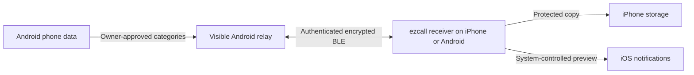

# ezcall security and device verification

The Android phone owner controls the relay. Android provides the approved call, SMS and contact data. An authenticated Bluetooth session carries only enabled categories to the linked iPhone. The iPhone keeps its local copy in app-private storage. Both apps support unlinking, which should be performed on both phones when decommissioning a pair.

| Risk | Control | Check |
| --- | --- | --- |
| Nearby observer or app reads SMS or contacts | Ephemeral P-256 keys, QR-authenticated handshake and AES-256-GCM at the app layer | Compare both implementations against the fixed test vector, then capture a pairing and verify no message content appears in BLE payloads |
| Impostor connects or replays a packet | High-entropy local QR secret, proof in both directions, independent counters and per-connection keys | Try a stale QR, wrong secret, modified ciphertext and repeated frame |
| Device owner loses control of disclosure | Explicit category permissions, visible Android service and unpair | Decline each permission, toggle it off, then unpair and try to reconnect with the old link |
| Private content appears on the iPhone lock screen or in backups | SMS previews follow system notification settings. The protected app-local cache is excluded from backup | Receive a sample SMS while locked, inspect the preview and check backup flags |
| Incomplete sync replaces valid history | Bounded frames, staged snapshots and matching request IDs | Disconnect halfway through a sync, then retry and verify the previous complete snapshot stays visible |
| First pairing confirmation is lost | Each receiver saves both reconnect keys before allowing the sender to rotate | During first pairing, break the link after the sender accepts the encrypted ready message and before its reply reaches the receiver. Restart the receiver, reconnect without scanning again and run Test connection. Repeat with the receiver's ready withheld until after disconnect to exercise the original key. |
| Nearby device stalls enrollment or reconnect | Bounded buffering and timeout for unauthenticated peers | Open an idle BLE connection from another device and verify the real pair can recover |
| Bluetooth or OS lifecycle stops delivery | Reconnect, authenticated test and sync on demand | Test lock, Bluetooth toggles, airplane mode with Bluetooth enabled, OS termination, app force-quit and both phones restarting |

## Call control and call audio

Call control uses Android's answer-calls and phone permissions under the separate **Call control** switch. Call audio needs a component that ezcall starts through the phone's own Wireless debugging connection. It runs as the shell user until Android restarts, because Android lets that user capture call audio. On phones with Android's call audio interception devices, it can also send the iPhone microphone into the call.

| Risk | Control | Check |
| --- | --- | --- |
| Another app uses the shell-user component | It listens only on loopback. A 32-byte token in app-private storage authenticates both sides with HMAC before audio flows. It accepts only start, stop, audio and shutdown. | Connect from another app or with a wrong token and verify that no audio flows. Check that `ps -A` lists one `ezcall_audio` |
| Nearby observer hears a call | Each call gets a fresh 32-byte audio key over the authenticated link. Packets use AES-256-GCM with direction-separated nonces and replay rejection. | Capture BLE traffic during a call and verify that no audio is recoverable |
| Audio reaches the iPhone without the owner's intent | Only a call answered or placed from the iPhone moves its audio. Calls answered on Android keep their audio there. | Answer on Android while linked and verify that the iPhone shows the call ended elsewhere |
| Caller identity appears on the iPhone lock screen | The iOS call screen shows the name and number when **Caller number** is enabled, like a normal phone call. Fallback call notifications stay generic. | Ring a locked iPhone with and without **Caller number** |
| The component outlives the owner's wish | Restarting Android stops it. Removing ezcall under **Paired devices** in Wireless debugging prevents restarts. | Restart Android and verify that call audio reports stopped |

An onlooker who captures the live pairing QR obtains the pairing credential. Treat it like a password and unpair on Android if it is exposed. Separate session keys protect earlier captured traffic from later exposure of the pairing credential. Device access, Android battery policy, iOS background limits and intentional radio interference affect availability.

Before public distribution, verify incoming SMS including multipart messages, outgoing SMS history, contact edit/deletion after sync, caller identity when permitted, hidden caller ID, consecutive calls, notification privacy, consent revocation, unpairing, and recovery from stale pair state. Run on Android 12 and a recent Android release with a physical iPhone, including protection of locked-device data and lock-screen notification behavior.
